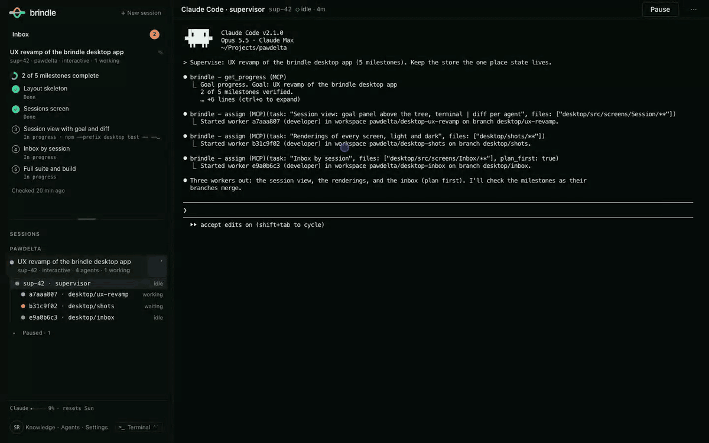
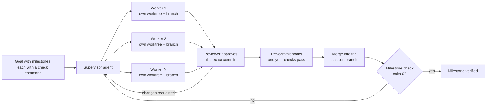
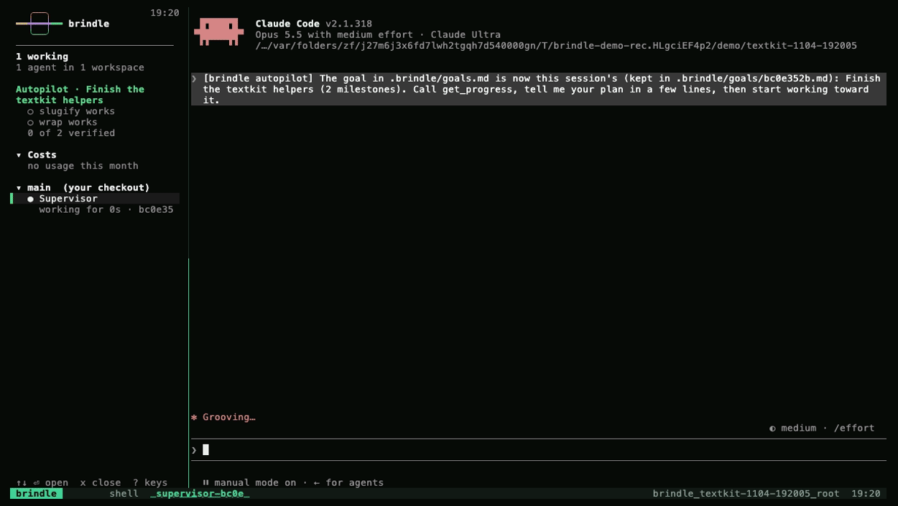

<p align="center">
  
</p>

<h1 align="center">brindle</h1>

<p align="center"><strong>A supervisor for your coding agents that won't call work done until it's proven.</strong></p>

<p align="center">
  <a href="https://pypi.org/project/brindle/"></a>
  <a href="https://github.com/PawDelta/brindle/actions/workflows/ci.yml"></a>
  <a href="https://pypi.org/project/brindle/"></a>
  
  <a href="https://github.com/PawDelta/brindle/blob/main/LICENSE"></a>
</p>

<p align="center">
  <a href="https://pawdelta.com/brindle/">Website</a> ·
  <a href="https://pawdelta.com/brindle/docs/">Docs</a> ·
  <a href="https://pawdelta.com/brindle/getting-started/">Download the app</a> ·
  <a href="https://pawdelta.com/brindle/changelog/">Changelog</a>
</p>

brindle runs Claude Code, Codex, Google Antigravity, OpenCode and open-weight models side by
side, each in its own git worktree. A supervisor agent splits the goal into milestones and
hands the work out. Every branch merges only after a reviewer approves that exact commit and
your checks pass. A milestone counts as done only when its check command exits 0.



*The desktop app on sample data: a supervisor and its workers in parallel, one inbox for
every decision, milestones verified one by one, then a reviewed PR.*

## Why

You already have a good coding agent. The ceiling isn't the model, it's everything around it:
one agent in one terminal, working serially on one checkout, with you as the test runner, the
reviewer, the permission prompt and the person who notices when it quietly stopped. brindle
is that missing layer.

| | One agent CLI, run by hand | brindle |
|---|---|---|
| Parallel work | One agent, one checkout. A second one fights over files and ports. | Each worker gets its own worktree and branch, cut from a freshly fetched base, with its own block of ports. Up to `max_agents` at once, five by default. |
| "Done" | The model says it's done. | A milestone's check command exits 0. brindle runs it itself and re-runs it after later merges to catch regressions. |
| Review | You read the diff, or you don't. | A reviewer agent approves the exact commit before it can merge. Have Codex review Claude's work, or a local model review both. |
| Tests | You remember to run them. | Pre-commit hooks and your `checks` gate every merge. Nothing merges red. |
| Walking away | The agent stops at the first question, usage limit or crash. | The session keeps going until every milestone passes, pauses at your usage limit and resumes after the reset. Quit and `brindle continue` later; workers resume too. |
| Interruptions | Every agent prompts in its own terminal. | Decisions, permission requests and finished work land in one inbox. The supervisor can answer routine permission asks itself. |
| Status | You read the terminal. | Each agent's state comes from its lifecycle hooks, not from scraping its screen. |

For a one-line fix, plain `claude` is quicker, and the supervisor will do small things itself
rather than start workers. brindle pays off when work splits into parallel pieces, or runs
long enough that you'd rather not babysit it.

Compared with: [Claude Squad](https://pawdelta.com/brindle/compare/claude-squad/) · [Conductor](https://pawdelta.com/brindle/compare/conductor/) ·
[Superset](https://pawdelta.com/brindle/compare/superset/) · [Claude Code subagents](https://pawdelta.com/brindle/compare/claude-code-subagents/)

## How a goal gets done



The supervisor delegates through brindle's own MCP tools: `assign` a task with the files it
will touch and the tasks it depends on, and brindle refuses overlapping work, queues dependent
tasks until their prerequisites merge, and starts them from the updated base. Large or risky
tasks can run plan-first: the worker proposes a plan and waits for approval before editing
(enforced by a hook for Claude Code workers; other CLIs are told to wait).
Every worker's worktree is snapshotted after each turn that changed files, so a worker that
went down the wrong path can be rewound to a good turn and restarted with a note, instead of
starting over.

Tell the supervisor what "done" means in commands, or write it yourself:

```markdown
<!-- .brindle/goals.md -->
# Settings page

## Settings API
check: uv run pytest tests/test_settings_api.py -q

## Settings UI
check: npm test -- settings
```

## Built with brindle

brindle is built with brindle. One developer's own history, 2026-10-05 to 2026-11-04, as
recorded by `brindle history`:

| | |
|---|---|
| Worker tasks completed | 1,609 across 24 repos |
| Reviews | 1,567, of which 729 (47%) sent the branch back with changes requested before it could merge |
| Branches merged | 529, each only after approval and passing checks |
| Milestone checks passed | 642 |
| Pull requests merged into brindle itself | 252 |

Nearly half of all reviews requested changes. That is the review gate doing its
job, and it's the number to look at when deciding whether unreviewed agent output belongs on
your main branch.

## Get started

You need at least one agent CLI installed and signed in. Claude Code is the default for the
supervisor, workers and reviewer (`npm install -g @anthropic-ai/claude-code`, then
`claude auth login`). The core workflow is free. The desktop app needs a free brindle account, with no payment
details; the CLI needs no account.

**The app** (macOS and Linux). Download it from
[pawdelta.com/brindle/getting-started](https://pawdelta.com/brindle/getting-started/), open
it, and under **New session** choose **Watch brindle work on a practice repo** to see a full
run before pointing it at your own code.

**The terminal** (macOS, Linux, or Windows through WSL2). The install script installs uv if
it's missing, then brindle, then runs `brindle doctor`. brindle needs tmux: on macOS the
script installs it with Homebrew; on Linux and WSL2 it prints the command to run, so install
tmux first (`sudo apt install tmux` on Debian and Ubuntu):

```sh
curl -fsSL pawdelta.com/brindle/install | sh
brindle demo              # the same practice run, in tmux
cd ~/code/myapp
brindle init              # once per repo: detects setup and test commands
brindle                   # a supervisor chat here, with the live sidebar
```



*The same demo from `brindle demo`, in tmux.*

The app and the CLI run on the same engine, so you can use both on the same sessions.

## Commands

| | |
|---|---|
| `brindle` | a fresh supervisor chat here, dashboard alongside; `-s codex` runs the supervisor on another CLI |
| `brindle init` | detect setup and test commands, write `.brindle/config.json`, check the tools |
| `brindle demo [--local]` | watch brindle finish a tiny practice repo; `--local` keeps workers and reviewers on Ollama |
| `brindle doctor` | check tmux, the agent CLIs and how each is signed in, and the repo's config and checks |
| `brindle continue [ID]` | resume a paused session, workers included (default: the most recent) |
| `brindle goal [check]` | the goal's progress; `check` runs the milestone checks now |
| `brindle history [--share]` | durable log of worker results, reviews, merges and milestone checks; `--share` summarizes the session in a few lines |
| `brindle ls` | workspaces and their agents |
| `brindle new BRANCH -p PROMPT` | a worktree, a branch and a supervisor in it, with its first message |
| `brindle pr [WS]` | push a workspace branch and open a pull request against its base |
| `brindle app` | open the desktop app, or print where to download it |
| `brindle web` | this session in your browser, on 127.0.0.1 only |

With no `WS` argument, commands act on the workspace you're in. The
[guide](https://github.com/PawDelta/brindle/blob/main/docs/guide.md#commands) lists the rest.

## Agents and models

| Provider | Supervisor | Worker / reviewer | Signs in with |
|---|---|---|---|
| Claude Code (`claude`) | yes, the default | yes | its own login, or `ANTHROPIC_API_KEY`; also Bedrock, Vertex and Foundry |
| Codex (`codex`) | yes | yes | its own login, or `OPENAI_API_KEY` |
| Google Antigravity (`agy`) | yes | yes | its own login, or `GEMINI_API_KEY` |
| OpenCode (`opencode`) | yes | yes | whatever the model's provider takes |
| Open-weight models, through brindle's own agent loop | no | yes | any OpenAI- or Anthropic-style endpoint: Ollama, LM Studio, llama.cpp or a hosted API |

brindle only offers a profile whose CLI is installed and signed in. The built-in
`developer-local` and `reviewer-local` profiles run Qwen3-Coder on Ollama; GLM, DeepSeek, Kimi
and gpt-oss work the same way, and Claude Code itself can be pointed at another
Anthropic-compatible backend from a profile. Profiles are Markdown files with frontmatter:
pick a provider, a model and a permission mode, write the prompt, and the supervisor routes
tasks to them by weight.

## FAQ

**Does it cost extra on top of my Claude or Codex plan?** No. brindle drives the CLIs you
already pay for, and the core workflow is free. The app needs a free brindle account, with no payment
details; the CLI needs none.

**Where does my code go?** Nowhere new. Agents run locally through your own CLIs, and brindle
keeps its state in `~/.brindle`. brindle sends no telemetry. It checks PyPI for updates
(`BRINDLE_NO_UPDATE_CHECK` turns that off) and otherwise talks only to what you set up: model
endpoints you configure, CI hosts, and your brindle account, which the app requires and the CLI only uses if you sign in.

**Windows?** The CLI runs in WSL2. The app is macOS and Linux for now.

**Can I use it on an existing repo?** Yes. Open the folder in the app, or run `brindle init`
in it once.

**What if a worker goes the wrong way?** Its branch can't merge without review and passing
checks, and its worktree is snapshotted after every turn that changed files, so you can
rewind it to a good turn instead of starting over.

## Learn more

- [The full guide](https://github.com/PawDelta/brindle/blob/main/docs/guide.md): every
  command, config option, provider, permission policy and paid feature.
- [Website and docs](https://pawdelta.com/brindle/)

## Contributing

Bug reports and pull requests are welcome. Contributions are covered by the
[Contributor License Agreement](https://github.com/PawDelta/brindle/blob/main/CONTRIBUTING.md);
the CLA bot asks you to sign it on your first pull request.

## License

Source-available, not open source. brindle is free to use, including at work, under the
[brindle License 1.0](https://github.com/PawDelta/brindle/blob/main/LICENSE): you may install
and run it, but not modify it (beyond the changes the license permits), redistribute it, or
use it to build a competing service. Details in the
[guide](https://github.com/PawDelta/brindle/blob/main/docs/guide.md#license).

This project is unrelated to the Brindle desktop app at brindle.dev.
